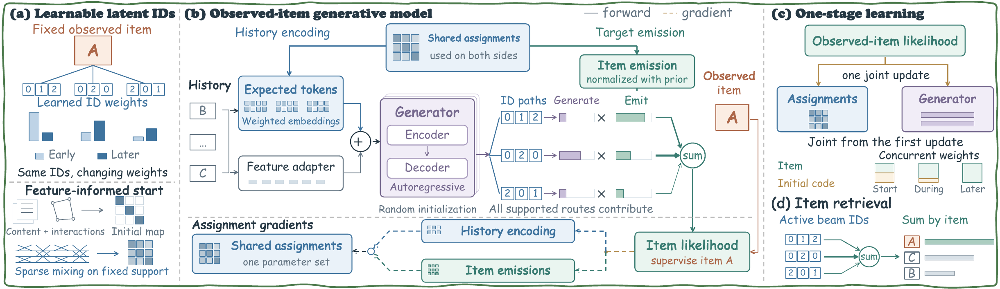

# OneJoint

**One-Stage Joint Learning with Latent Semantic Identifiers for Generative Recommendation**

OneJoint learns latent semantic identifier assignments, an autoregressive generator, and the observed-item likelihood from the first recommendation update.



No tokenizer-only phase, RQ-VAE checkpoint, or neural tokenizer pretraining is used. The item feature matrix initializes the latent identifier structure; all trainable assignment, history, generator, and item-likelihood components are optimized in the same recommendation stage.

## Main Components

- Sparse balanced latent-identifier tree with feature-informed initialization.
- Sparse item-to-identifier routing with a valid bijective hard map.
- Shared assignment probabilities for history encoding and target-item emission.
- Exact sparse marginalization of supported identifier paths into observed-item likelihood.
- Decaying initial-identifier guidance for early optimization.
- Validation-selected checkpoint and one final test evaluation.

## Layout

```text
OneJoint/
  train_onejoint.py              Clean no-pretraining entry point
  model.py                       Autoregressive generator wrapper
  data.py                        Sequential recommendation data loading
  mintgr/                        Sparse routing and item-likelihood modules
  config/onejoint.yaml           Default OneJoint configuration
  scripts/run_onejoint.sh        Run one dataset
  scripts/run_all_datasets.sh   Run Beauty, Instruments, and Yelp sequentially
  assets/method.png              Method figure for this README
  assets/method.pdf              Vector method figure
  requirements.txt               Python dependencies
```

The internal `mintgr/` module names are retained from the reference implementation; the public entry point and configuration are OneJoint-specific. The training path explicitly rejects any non-null RQ-VAE checkpoint.

## Environment

Use Python 3.10 or newer. Install dependencies:

```bash
cd /path/to/OneJoint
python -m venv .venv
. .venv/bin/activate
pip install -r requirements.txt
```

CUDA is recommended for the reported-scale experiments. A small CPU run can be used to validate the pipeline.

## Data Layout

Set `ONEJOINT_DATA_ROOT` to a directory containing:

```text
<data-root>/
  beauty/
    beauty.train.jsonl
    beauty.valid.jsonl
    beauty.test.jsonl
    beauty.emb_map.json
    Beauty.emb-llama.npy
  instruments/
    instruments.train.jsonl
    instruments.valid.jsonl
    instruments.test.jsonl
    instruments.emb_map.json
    Instruments.emb-llama.npy
  yelp/
    yelp.train.jsonl
    yelp.valid.jsonl
    yelp.test.jsonl
    yelp.emb_map.json
    Yelp.emb-llama.npy
```

The JSONL records contain an interaction history and one target item:

```json
{"inter_history": ["item-a", "item-b"], "target_id": "item-c"}
```

The map must contain contiguous item IDs and reserve `0` for padding:

```json
{"[PAD]": 0, "item-a": 1, "item-b": 2}
```

The semantic embedding matrix has one row per non-padding item. It is used for feature-informed initialization; it is not a pretrained tokenizer or checkpoint.

## Run One Dataset

```bash
cd /path/to/OneJoint
ONEJOINT_DATA_ROOT=/path/to/data \
ONEJOINT_OUTPUT_ROOT=/path/to/outputs \
bash scripts/run_onejoint.sh beauty 0
```

The dataset launcher supports all three datasets:

```bash
bash scripts/run_onejoint.sh beauty 0
bash scripts/run_onejoint.sh instruments 0
bash scripts/run_onejoint.sh yelp 0
```

The second argument is the visible physical GPU index. The launcher selects the dataset-specific epoch, evaluation batch size, and beam width used by the reference configuration.

The launcher sets conservative BLAS/OpenMP thread defaults to avoid native thread-runtime conflicts on macOS. Override `OMP_NUM_THREADS`, `OPENBLAS_NUM_THREADS`, or `MKL_NUM_THREADS` when the target environment is configured differently.

## Run All Three

Run sequentially on one GPU:

```bash
ONEJOINT_DATA_ROOT=/path/to/data \
ONEJOINT_OUTPUT_ROOT=/path/to/outputs \
bash scripts/run_all_datasets.sh 0
```

## CPU Smoke Test

Use a small synthetic or reduced dataset and override the training budget:

```bash
ONEJOINT_DATA_ROOT=/path/to/data \
ONEJOINT_OUTPUT_ROOT=/tmp/onejoint-smoke \
ONEJOINT_PYTHON="$PWD/.venv/bin/python" \
bash scripts/run_onejoint.sh beauty 0
```

For a strict reduced run, invoke the entry point directly and add command-line overrides such as `--max_train_batches=1`, `--mint_max_eval_batches=1`, `--epochs=1`, and `--num_workers=0`.

## Outputs

Runs write logs, validation-selected checkpoints, manifests, validation histories, and final test metrics below `ONEJOINT_OUTPUT_ROOT`. Generated data, checkpoints, logs, and caches are ignored by `.gitignore`.

The manifest records `tokenizer_pretraining: false`, the resolved configuration, validation selection, and final test status.

